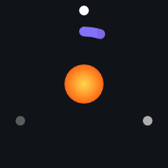
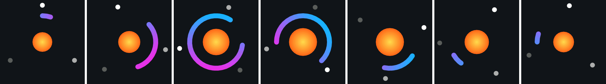

# LottieMCU

[](LICENSE)


A minimal-footprint [Lottie](https://airbnb.io/lottie/) animation player for Arduino-compatible
microcontrollers: ESP32 (all variants), RP2040, STM32, SAMD51/SAMD21, nRF52, Teensy and anything
else with a C++11 Arduino core and enough RAM.

<p align="center">
  <a href="https://www.paypal.com/paypalme/jobitjoseph">
    
  </a>
</p>

<p align="center">
  
</p>


<p align="center">
  
</p>



- **No JSON on the device.** A PC-side converter turns the Lottie `.json` into a compact binary
  (typically 10–25 % of the JSON size) that plays straight from flash/PROGMEM, or from a file.
- **No framebuffer.** Frames are rendered a strip of lines at a time (16 by default) and handed to
  your display through a callback. A 240×240 display needs ~54 KB of working RAM with the default
  limits, ~14 KB with the small profile used automatically on 32 KB boards.
- **Anti-aliased** scanline rasteriser, RGB565 output, works with TFT_eSPI, LovyanGFX,
  Adafruit_GFX, or your own SPI code.
- **Image layers too:** embedded or external PNG/JPEG images are pre-scaled to your display
  size by the converter and drawn with rotation, scaling, transparency and masks.
- **PSRAM aware:** on ESP32 boards with PSRAM the large working tables can live there
  (`cfg.usePSRAM`, on by default), keeping internal RAM free.
- **Small code:** ~13–15 KB of flash on ARM Cortex-M, one `.h` + one `.cpp`, no dependencies.

## Installation

- **Arduino IDE:** download the latest release ZIP from
  [github.com/jobitjoseph/LottieMCU/releases](https://github.com/jobitjoseph/LottieMCU/releases),
  then *Sketch → Include Library → Add .ZIP Library…*
- **Git:** clone into your Arduino `libraries` folder:
  `git clone https://github.com/jobitjoseph/LottieMCU.git`
- **PlatformIO:** `lib_deps = https://github.com/jobitjoseph/LottieMCU.git`

The converter lives in `tools/lottie2mcu.py` and needs only Python 3
(`pip install pillow` is optional, for JPEG images and better image scaling).

## Quick start

1. **Convert your animation** (Python 3, standard library only):

   ```
   python tools/lottie2mcu.py my_anim.json -o my_anim.h -n my_anim --size 320x240
   ```

   `--size` is your display resolution. It only matters for animations with image layers
   (images are stored at the size they'll actually be shown), but it never hurts to pass it.
   The tool prints the size, the largest path, the images, and a warning for every Lottie
   feature it had to drop or approximate.

2. **Play it:**

   ```cpp
   #include <TFT_eSPI.h>
   #include <LottieMCU.h>
   #include "my_anim.h"

   TFT_eSPI tft;
   LottieMCU lottie;

   void flush(int16_t x, int16_t y, uint16_t w, uint16_t h, const uint16_t *px, void *) {
     tft.pushImage(x, y, w, h, (uint16_t *)px);
   }

   void setup() {
     tft.init();
     tft.setSwapBytes(true);
     lottie.begin(my_anim, tft.width(), tft.height());  // scaled to fit, centred
     lottie.setFlush(flush);
   }

   void loop() {
     lottie.update(millis());  // renders the frame for "now", looping
   }
   ```

To load animations at runtime (LittleFS / SD), convert with `--bin my_anim.lmc` and pass the
file contents in RAM to `begin()` — see `examples/ESP32_LittleFS`.

## Examples

| Example | What it shows |
|---|---|
| `TFT_eSPI_Basic` | Looping playback on any TFT_eSPI display |
| `EcoGreenBulb` | An all-vector animation example (source in `extras/eco_green_bulb`) |
| `Adafruit_GFX_ST7789` | Same with Adafruit_GFX (works on SAMD21 with the small memory profile) |
| `ESP32_LittleFS` | Loading `.lmc` files from the filesystem, PSRAM if present |
| `Benchmark` | No display needed: render time per frame and buffer usage, to size `Config` |

## Converter reference (`tools/lottie2mcu.py`)

```
python lottie2mcu.py INPUT.json [-o OUT.h] [-n NAME] [--bin OUT.lmc] [--size WxH] [--image-scale F]
```

| Option | Default | Meaning |
|---|---|---|
| `INPUT.json` | — | Lottie / Bodymovin JSON. External images are looked up relative to this file. |
| `-o`, `--output` | `INPUT.h` | C header containing the animation as a `const uint8_t NAME[] PROGMEM` array (plus `NAME_len`). Written unless you *only* ask for `--bin`. |
| `-n`, `--name` | file name | Array name used in the header, e.g. `-n my_anim` → `my_anim[]`. Characters that aren't letters/digits become `_`; a leading digit gets an `anim_` prefix. |
| `--bin` | — | Also (or instead) write the raw binary, for loading from LittleFS/SD at runtime. |
| `--size WxH` | animation size | Display resolution the animation will be shown at, e.g. `320x240`. Image layers are stored at the size they actually appear on that display (accounting for layer scaling), which saves a lot of flash. Has no effect on vector-only animations. |
| `--image-scale F` | `1.0` | Extra factor on stored image resolution. `0.5` = half resolution, ¼ of the flash. Values above 1 store sharper images (useful if you zoom with `setTransform`). |
| `--version` | — | Print the converter version and exit. |

After converting it prints the animation size and frame range, the number of nodes / paths /
draw items, the binary size, every image with its stored resolution, the **largest path**
(set `Config::maxPathVerts` at least this high) and one **warning** per unsupported feature
it dropped or approximated. Warnings don't stop the conversion; check the result with the
Benchmark sketch or on screen.

Python 3 standard library only; if Pillow is installed it's used for image decoding/resampling
(required for JPEG/WebP images).

## API reference

### Setup

| Function | Description |
|---|---|
| `bool begin(const uint8_t *data, uint16_t width, uint16_t height, const Config &cfg = Config())` | Prepares an animation for an output of `width`×`height` pixels and allocates all working memory. `data` is the converter output (a flash array or a RAM buffer); it is **not copied**, so it must stay valid while the animation plays. The animation is scaled to fit and centred. Returns `false` on error (see `status()`). Calling `begin()` again switches animation (memory is released and re-allocated). |
| `void end()` | Frees all memory. Called automatically by `begin()` and the destructor. |

### Output

| Function | Description |
|---|---|
| `void setFlush(FlushFn fn, void *user = nullptr)` | Required. `fn(x, y, w, h, pixels, user)` is called once per strip of finished pixels: `x` is always 0, `w` is the output width, `h` ≤ `bandHeight`, `pixels` holds `w*h` RGB565 values row by row. The buffer is reused for the next strip, so copy it or finish sending it before returning (for DMA, wait for completion). `user` is passed through unchanged. |
| `void setBackground(uint16_t rgb565)` | Colour behind the animation and in the letterbox area. Default black (`0x0000`). |
| `void setSwapBytes(bool swap)` | Byte-swap the RGB565 output. Use `true` when your driver expects the panel's big-endian order without converting (e.g. LovyanGFX/M5GFX `swap565_t`). With TFT_eSPI, use `tft.setSwapBytes(true)` instead. |
| `void setTransform(float scale, float offsetX, float offsetY)` | Custom placement instead of fit-and-centre: animation units are multiplied by `scale` and shifted by the offset in output pixels. Call it **after** `begin()` (which resets placement). |

### Playback

| Function | Description |
|---|---|
| `bool renderFrame(float frame)` | Renders the given Lottie frame number (between `firstFrame()` and `lastFrame()`, fractional allowed) and flushes it. Use this to control timing yourself: custom speed, reverse, ping-pong, scrubbing, or stepping every frame. |
| `bool update(uint32_t nowMs)` | Renders the frame for "now", playing at the animation's own frame rate and looping. Pass `millis()`. The first call marks the start. If rendering is slower than the frame rate, frames are skipped but timing stays correct. |
| `void restart()` | Makes the next `update()` start again from the first frame. |

Both return `false` if `begin()` didn't succeed or no flush callback is set.

### Animation info

| Function | Description |
|---|---|
| `uint16_t animWidth()`, `animHeight()` | Size of the animation's own canvas. |
| `float frameRate()` | Frames per second the animation was designed for. |
| `float firstFrame()`, `lastFrame()`, `totalFrames()` | Frame range (Lottie in/out points). |
| `uint32_t durationMs()` | Length of one loop in milliseconds. |
| `Status status()` | Result of the last `begin()`: see below. |

| `Status` | Meaning |
|---|---|
| `OK` | Ready to play. |
| `ERR_FORMAT` | Not LottieMCU data, truncated, or produced by an incompatible converter version: re-convert. |
| `ERR_NOMEM` | Not enough RAM for the configured limits: lower them, reduce `bandHeight`, or enable PSRAM. |
| `NOT_STARTED` | `begin()` not called yet, or `end()` was called. |

### Per-frame statistics: `const Stats &stats()`

Filled by every `renderFrame()`/`update()`. Use it (or the Benchmark sketch) to size `Config`.

| Field | Meaning |
|---|---|
| `points`, `contours`, `items` | Polygon points, polygons and fills/strokes/images used by the last frame. Compare with `maxPoints`, `maxContours`, `maxItems`. |
| `overflowPoints` | `maxPoints` or `maxContours` ran out: some shapes were skipped. |
| `overflowCurve` | One path flattened to more than `maxCurvePoints` points: it was cut short. |
| `overflowVerts` | A path or gradient has more data than `maxPathVerts` allows: raise it to the converter's "largest path" value. |
| `overflowCross` | A scanline crossed more than `maxCrossings` edges: rare, causes streaks in very complex shapes. |
| `overflowItems` | More than `maxItems` fills/strokes/images were visible: the topmost ones were skipped. |
| `overflowGradients` | More than `maxGradients` gradients were visible: the extra ones were drawn in their average colour. |
| `overflowImages` | More than `maxImages` image layers were visible: the extra ones were skipped. |

### Memory and version

| Function / macro | Description |
|---|---|
| `static uint32_t ramNeeded(const Config &cfg, uint16_t width)` | Working memory `begin()` will allocate for a config and output width, before the (small) per-animation tables. Use it to budget before calling `begin()`. |
| `uint32_t ramUsed()` | Total heap bytes allocated by the last successful `begin()`. |
| `uint32_t psramUsed()` | The part of `ramUsed()` that is in PSRAM (ESP32 with `usePSRAM`). |
| `LOTTIEMCU_VERSION` | Version string, e.g. `"1.1.0"`; also `LOTTIEMCU_VERSION_MAJOR`, `_MINOR`, `_PATCH`. |
| `LOTTIEMCU_SMALL` | Define before `#include <LottieMCU.h>` to use the small-RAM default limits on any board. |

## Memory

All memory is allocated once in `begin()`; nothing is allocated while playing. The limits live in
`LottieMCU::Config`:

| Field | Default | Small profile | Meaning |
|---|---|---|---|
| `bandHeight` | 16 | 4 | lines per flush (RAM = width × bandHeight × 2) |
| `maxPoints` | 4096 | 1024 | polygon points per frame |
| `maxContours` | 1024 | 256 | polygons per frame |
| `maxItems` | 192 | 48 | fills/strokes per frame |
| `maxCurvePoints` | 512 | 128 | points in one flattened path |
| `maxPathVerts` | 256 | 32 | bezier vertices in one path (the converter prints what you need) |
| `maxCrossings` | 128 | 64 | edges crossing one scanline of one shape |
| `maxGradients` | 8 | 2 | gradient fills per frame |
| `maxImages` | 8 | 2 | image layers drawn per frame |
| `subSamples` | 4 | 4 | vertical anti-aliasing samples (1, 2, 4, 8) |
| `tolerance` | 0.3 | 0.3 | curve flattening error in pixels |
| `bilinear` | true | true | smooth image sampling; `false` = nearest pixel, ~2× faster on image-heavy frames |
| `usePSRAM` | true | true | ESP32 only: large tables go to PSRAM when present (see below) |

Everything is set in your sketch before `begin()`:

```cpp
LottieMCU::Config cfg;
cfg.usePSRAM     = true;   // false: keep everything in internal RAM
cfg.maxGradients = 24;
cfg.maxImages    = 8;
lottie.begin(my_anim, 320, 240, cfg);
Serial.printf("RAM %u bytes, %u in PSRAM\n", lottie.ramUsed(), lottie.psramUsed());
```

**PSRAM (ESP32):** with `usePSRAM = true` and PSRAM present, the point/polygon/item tables,
gradient tables and per-animation tables are allocated in PSRAM; the strip buffer and the
scanline buffers always stay in internal RAM because they are touched for every pixel. If
there is no PSRAM, or the board isn't an ESP32, everything simply goes to internal RAM. PSRAM
is slower than internal RAM, so if you have internal RAM to spare, compare both settings with
the `Benchmark` sketch. Animation data you load at runtime can go to PSRAM too
(`ps_malloc`, see `examples/ESP32_LittleFS`).

The small profile is used automatically on AVR, SAMD21 and Renesas (UNO R4) boards, or when you
define `LOTTIEMCU_SMALL` before including the library. Run the `Benchmark` sketch with your
animation: if it reports an overflow, raise the matching limit; if it doesn't, you can lower them.
Complex animations rendered large need more points, so test at your real display size.

## Performance tuning

Rendering time grows with the number of pixels covered, the number of shapes, and image
area. In rough order of effect:

| Setting | Effect |
|---|---|
| `subSamples = 2` (or `1`) | Fewer anti-aliasing passes; the biggest single speed-up. `2` still looks smooth, `1` gives jagged edges. |
| Smaller output | `begin(data, 240, 180)` plus `setTransform()` to position it: time scales with area. |
| `bilinear = false` | Nearest-pixel image sampling, ~2× faster on image-heavy frames. |
| `tolerance = 0.6` | Fewer points per curve, hardly visible on small screens. |
| `bandHeight` larger | Fewer, bigger transfers to the display (costs `width × bandHeight × 2` bytes). |
| `usePSRAM = false` | If internal RAM allows, keeps everything in faster internal RAM. |

To change **playback speed** (not rendering speed), drive `renderFrame()` with your own
frame counter, e.g. `frame += dtSeconds * frameRate() * speed`. To cap the **refresh rate**,
only call `update()` when enough time has passed; playback timing stays correct.

## What's supported

| | Supported | Not supported / approximated |
|---|---|---|
| Layers | shape, solid, null, image, precomp (nested), parenting, in/out points, start time | text, time remap, time stretch |
| Shapes | path, rectangle (rounded), ellipse, polystar, groups | merge paths, round corners, offset path, twist, zig-zag |
| Styles | fill (non-zero / even-odd), stroke (butt/round/square caps, miter/round/bevel joins), linear & radial gradient fill/stroke with opacity stops | dashes, gradient highlight |
| Modifiers | trim paths, repeater (incl. animated count, negative offset) | trim "simultaneously" across several paths (done per path) |
| Transforms | anchor, position (incl. split X/Y and curved motion paths), scale, rotation, skew, opacity | 3D: X/Y rotation is an orthographic approximation |
| Masking | masks (add, subtract, inverted), track mattes (alpha & inverted alpha; luma treated as alpha) | mask feather/expansion/opacity, intersect/difference modes |
| Animation | linear, bezier-eased and hold keyframes, per-dimension easing | expressions, effects, blend modes |

Curved motion paths and per-dimension easing are resampled to one key per frame by the
converter, so the device only needs simple interpolation.

### Image layers

Images (embedded `data:` URIs or files next to the JSON) are decoded by the converter, scaled
to the largest size they appear at on your display (`--size`, taking layer scaling into
account), cropped to their visible area and stored as RGB565 plus an 8-bit alpha channel
(3 bytes per pixel; 2 for fully opaque images). PNG works with plain Python; JPEG/WebP need
Pillow (`pip install pillow`), which is also used for higher-quality resampling when present.

Images cost flash: a 240×240 display showing a few large images typically needs 50–150 KB.
`--image-scale 0.5` halves the resolution (a quarter of the flash) if you need to save space.
Images used as track mattes contribute their rectangle (their transparency is ignored).

## How it was verified

The renderer was compared frame by frame against two reference implementations — rlottie
(Samsung) and python-lottie (which follows lottie-web) — on the 93 sample animations in the
rlottie repository: 86 match at least one reference with a mean pixel difference under 3/255.
The rest use unsupported features (merge paths, dashes) or differ where the two references
also disagree. Image layers match rlottie to within ~2/255 on simple scenes; on heavily
downscaled illustrations LottieMCU's pre-filtered images are smoother than rlottie's output.
It builds without warnings for ESP32 (with and without PSRAM), RP2040, SAMD21 and STM32F4.

## Binary format

Little-endian: a 36-byte header (`"LMC1"`, size, frame rate, in/out frames, section counts,
total length) followed by transform nodes, paths, trim modifiers, clips, images and draw items.
Animated values are 16-bit with a per-property scale; keyframe times are ¼-frame resolution.
`tools/lottie2mcu.py` documents each record.

## Contributing

Bug reports, animations that don't render correctly, and pull requests are welcome at
[github.com/jobitjoseph/LottieMCU/issues](https://github.com/jobitjoseph/LottieMCU/issues).
When reporting a rendering problem, please attach the Lottie `.json` and the converter's output.

## Author

**Jobit Joseph** — [github.com/jobitjoseph](https://github.com/jobitjoseph) · jobitjoseph1@gmail.com

## License

Copyright (c) 2026 Jobit Joseph.

LottieMCU is released under the [MIT License](LICENSE): you can use it in personal and
commercial projects, modify and redistribute it, as long as the copyright notice and licence
text are kept.

Animations are not part of the library's licence. The demo animation in `extras/` is original
and MIT-licensed with the library; any other Lottie file you convert keeps its own licence.
